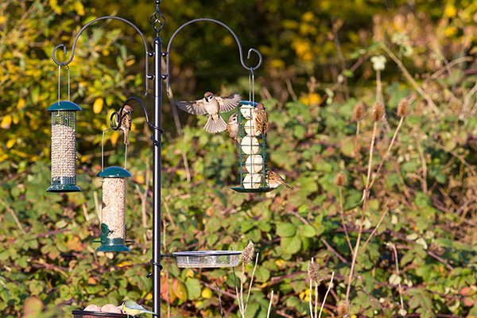
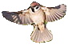

# BirdSpotter

BirdSpotter watches a camera, and uses computer vision to make bird cutouts.

A greyscale motion gate picks frames where something has arrived, and SAM 3 segments
the bird in them.

Once a second, the ROI crop is shrunk to 120 px greyscale and compared against the
per-pixel median of the previous minute's frames. Its score is the largest 3x3-averaged
difference in grey levels. Within each five-minute window, the highest-scoring frame, if
past `--motion-threshold`, goes to SAM 3.

| Frame | Segmentation |
| --- | --- |
|  |  |

## Setup

```bash
uv sync --locked
```

```bash
uv run python scripts/download_models.py
```

## Demo

```bash
uv run python scripts/generate_demo.py
```

## Deployment

```bash
uv run python scripts/deploy.py
```

## Tests and checks

```bash
uv run pytest
uv run pre-commit run --all-files
```
